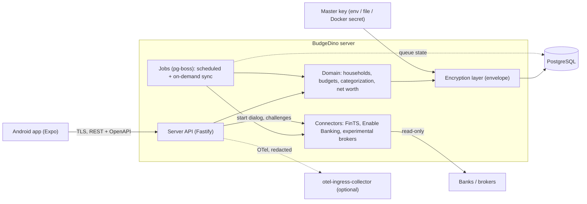

# Architecture

- Origin: [founding design](specs/2026-11-08-budgedino-design.md) §11, §13, §14. **[owner]** = decided
  by the owner, **[call]** = AI's call, may be challenged.

## Overview

- The app talks only to its own server. Data fetching runs on the server; interactive bank steps are
  started by the user in the app and handled as typed challenges.
- Sensitive fields are encrypted at application level; the master key never lives in the database.
- Connectors sit behind one interface and are replaceable.

## Stack **[call]** unless marked

TypeScript throughout. **[owner]**

- **Monorepo** (pnpm workspaces): `src/server`, `src/mobile`, `src/shared` (types, zod schemas,
  money/date logic), `tests/`, `ci/`, `docs/`.
- **Server:** Node.js LTS, Fastify, zod-validated REST API with generated OpenAPI, Drizzle ORM,
  PostgreSQL, pg-boss for scheduled/background jobs (Postgres-backed, no Redis).
- **Mobile:** Expo (latest SDK, development builds, not Expo Go), React Native, Android first. **[owner]**
- **Money:** integer minor units + ISO currency; never floating point.
- **Observability:** OpenTelemetry (traces, metrics, structured logs with TraceId/SpanId) exported to
  the owner's otel-ingress-collector (OpenObserve/SigNoz); optional and off by default for other
  self-hosters. Redaction per [security.md](specs/security.md).

## Testing strategy

Strong testing is a core requirement. **[owner]** **[call]** on specifics:
- TDD for domain logic.
- **Unit:** Vitest; property-based tests (fast-check) for money, budgets periods, transfer detection,
  categorization precedence, deduplication.
- **Integration:** Testcontainers Postgres; encryption round-trips and "no plaintext at rest" checks
  on the real database.
- **Connector tests:** contract tests against recorded, anonymized fixtures; Enable Banking sandbox;
  a fake FinTS server for deterministic flows. Live-bank tests are opt-in and never in CI.
- **API end-to-end:** full server against fake connectors.
- **Mobile end-to-end:** Maestro flows on a physical Android device or the device farm (no emulator
  without explicit owner approval each time).
- Security tests: visibility enforcement (member cannot fetch `owner-only` data via any endpoint),
  log redaction.
- CI runs unit, integration, connector contract and API e2e on every PR.

## Versioning

Semantic versioning via GitVersion 5.x, Mainline mode. **[call]** (owner default)
